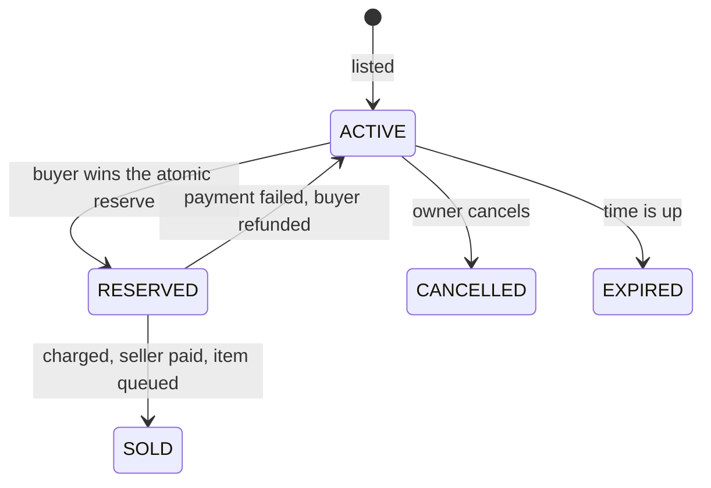

<div align="center">


# JustAuction

**A safe, fast auction house for Paper.**
Fixed-price listings, timed auctions with bidding, a clean GUI, and sales that can never duplicate an item or lose money.

[](https://papermc.io)
[](https://adoptium.net)
[](LICENSE)
[](https://github.com/filasik/JustAuction/actions)

</div>

---

## Highlights

- **Auctions.** Timed auctions with bids, optional buyout and anti-sniping, next to fixed-price listings.
- **Dupe-proof by design.** Every sale goes through one guarded state machine; two buyers can never both win.
- **Never blocks the server.** All database work is asynchronous.
- **Crash-safe.** Interrupted purchases are recovered on the next start; failed payments are refunded.
- **Works with your economy.** Anything that registers with [Vault](https://github.com/MilkBowl/Vault) (EssentialsX, CMI, ...).
- **Low maintenance.** Drop-in jar, SQLite by default, MariaDB/MySQL optional, update notices from GitHub.
- **Fully yours.** Every message is editable (MiniMessage). English and Czech included.
- **Optional public announcements.** Tell the whole server about new listings, sales and auction results (off by default).
- **For developers.** Cancellable API events and PlaceholderAPI placeholders.

## Quick start

1. Install **Vault** (or VaultUnlocked) and an economy plugin.
2. Put `JustAuction-1.1.0.jar` in `plugins/` and start the server.
3. Hold an item and run `/ja sell 500`. Everyone else opens the market with `/ja`.

> The first start downloads the database drivers from Maven Central, so it needs internet once.

## Requirements

| | |
|---|---|
| Server | Paper **26.3** (Paper only) |
| Java | **25** |
| Economy | Vault or VaultUnlocked **and** an economy plugin that registers with it |

CMI's own economy only reaches Vault through CMI's Vault bridge (CMI Injector). With no Vault economy, JustAuction logs a clear error and disables itself.

## Commands

`/ja` — aliases `/auction` and `/ah` are configurable (`command.aliases`).

| Command | What it does | Permission |
|---|---|---|
| `/ja` | Open the auction house | `justauction.use` |
| `/ja sell <price>` | List the item in your hand (`1500`, `12.5`, `2k`, `1.5m`) | `justauction.sell` |
| `/ja auction <start> [buyout]` | Start a timed auction | `justauction.auction` |
| `/ja bid <id> <amount>` | Bid on an auction (the id is shown in the item lore) | `justauction.use` |
| `/ja buyout <id>` | Buy an auction out at once | `justauction.use` |
| `/ja mylistings` | View and cancel your listings | `justauction.use` |
| `/ja claim` | Collect expired, cancelled and undelivered items | `justauction.use` |
| `/ja search <text>` | Filter by name, material or enchantment | `justauction.use` |
| `/ja history` | Your last sales and purchases | `justauction.use` |
| `/ja reload` | Reload configuration and messages | `justauction.admin` |
| `/ja admin remove <id>` | Remove a listing (item goes to the owner's claims) | `justauction.admin` |

## Permissions

| Permission | Default | |
|---|---|---|
| `justauction.use` | everyone | Browse and buy |
| `justauction.sell` | everyone | Create listings |
| `justauction.auction` | everyone | Start auctions |
| `justauction.broadcast.receive` | everyone | See the public announcements (negate it to opt out) |
| `justauction.admin` | op | Reload, remove listings, update notices |
| `justauction.limit.<n>` | — | Max simultaneous listings (highest wins) |
| `justauction.bypass.limit` | — | Ignore the listing limit |

## Configuration

```yaml
listing:
  duration-hours: 48
  min-price: 1.00
  max-price: 1000000000.00
  sales-fee-percent: 5          # removed from the economy
  listing-fee: 0
  claim-retention-days: 7       # unclaimed items are deleted afterwards (0 = keep)
  default-max-listings: 5
  blacklist:
    materials: [BEDROCK, BARRIER, SPAWNER]
    check-container-contents: true   # shulker boxes and bundles too
storage:
  type: sqlite                  # or mariadb
```

```yaml
auction:
  enabled: true
  duration-hours: 24
  min-increment-percent: 5      # every bid must beat the top bid by this much
  anti-snipe-seconds: 120       # a bid in the last N seconds extends the auction to N seconds from now
broadcast:                      # public announcements, all off by default
  min-price: 0                  # skip cheap trades
  listed: false                 # item put on sale
  sold: false                   # fixed-price item bought
  auction-started: false
  auction-bid: false            # new top bid
  auction-won: false            # auction ended with a winner (or buyout)
metrics: true                   # bStats
economy:
  backend: auto                 # auto | vault | vault2
```

`config.yml` is fully commented, and new options are added to an existing file automatically on update (your values stay, a backup is saved). Messages live in `messages_<locale>.yml`.

## Auctions

`/ja auction 100` starts an auction for the item in your hand with a starting price of 100; `/ja auction 100 500` adds a buyout price of 500. Players click the auction in `/ja`: the bid screen offers the minimum next bid and the buyout, `/ja bid <id> <amount>` places any higher bid.

- A bid is taken from the bidder at once. When somebody outbids them, the money is returned; that refund is written to the database in the same transaction that accepts the new bid, so it survives crashes and an economy that is briefly unavailable.
- A bid in the last `anti-snipe-seconds` extends the auction, so nobody can win with a last-second bid.
- When time runs out the top bidder receives the item, the seller the bid minus the sales fee. If the seller cannot be paid, the winner is refunded and the item goes back to the seller. An auction without bids expires like a listing.
- An auction that already has bids cannot be cancelled by its seller. An admin removal refunds the top bidder.

## Public announcements

Under `broadcast` in `config.yml` you can switch on separate chat announcements for: an item put on sale, a fixed-price sale, a started auction, a new top bid and an auction result. Item names show their tooltip on hover, `min-price` keeps cheap trades quiet, and players can opt out with `justauction.broadcast.receive`. The texts are in `messages_<locale>.yml` under `broadcast`.

## For developers

Cancellable events (fired on the main thread, before any money moves): `ListingCreateEvent`, `ListingPurchaseEvent`, `AuctionBidEvent`. Informational: `ListingSoldEvent`. All in `me.skerik.justauction.api.event`.

PlaceholderAPI (optional): `%justauction_active_listings%`, `%justauction_my_listings%`, `%justauction_my_claims%`.

Economy: the classic Vault API is used when it is registered; otherwise JustAuction falls back to VaultUnlocked's own (v2) API. Force one with `economy.backend`.

## Statistics

JustAuction reports anonymous usage statistics to [bStats](https://bstats.org) (server count, Minecraft version, storage type, language, economy plugin, whether auctions and announcements are on). Switch it off with `metrics: false` or globally in `plugins/bStats/config.yml`.

## How a purchase works



An auction ends the same way: the winning bid is already held, so settling reserves the listing for the winner, pays the seller and finishes the sale (or refunds the winner and returns the item).

Reserving is a single guarded database update, so a second buyer is turned away before any money moves. Each money step is journaled; after a crash the plugin finishes or reverts whatever was in flight. Items always pass through claim storage, so a full inventory never loses one.

## Compatibility

- **Folia:** the code schedules through one abstraction, but Folia has no 26.3 build yet, so it is untested and disabled.
- **MariaDB/MySQL:** tested against MySQL (unit tests and live server runs). MySQL 8+ with its default self-signed certificate needs `storage.mariadb.ssl-mode: trust`. A real MariaDB server is untested; SQLite remains the default.

## Building

```bash
./gradlew build         # JDK 25, runs the unit tests, jar in build/libs
./gradlew runServer     # local Paper with a fake in-memory economy
```

## License

[MIT](LICENSE) © Filip Skerik
