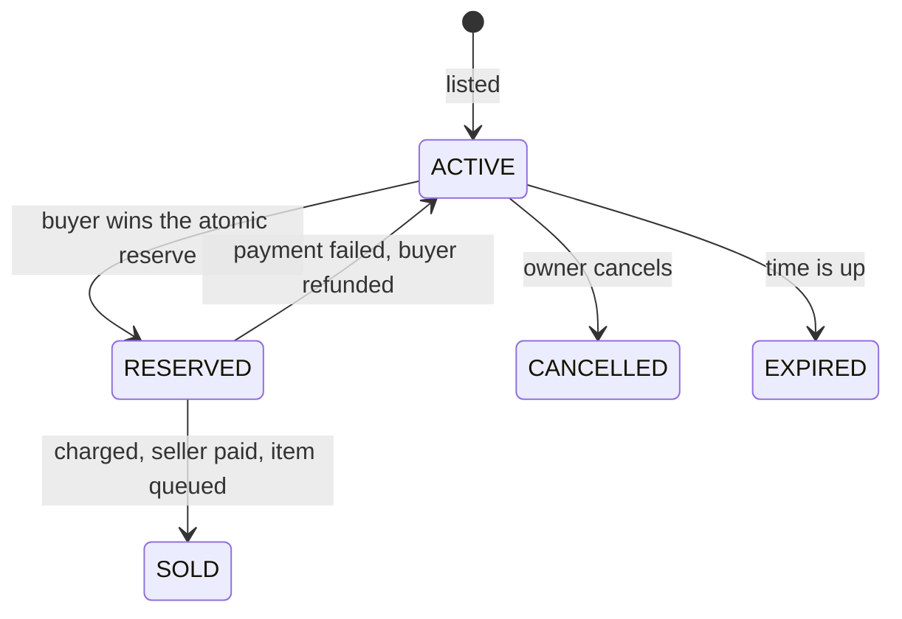

<div align="center">


# JustAuction

**A safe, fast auction house for Paper.**
Fixed-price listings, a clean GUI, and purchases that can never duplicate an item or lose money.

[](https://papermc.io)
[](https://adoptium.net)
[](LICENSE)
[](https://github.com/filasik/JustAuction/actions)

</div>

---

## Highlights

- **Dupe-proof by design.** Every sale goes through one guarded state machine; two buyers can never both win.
- **Never blocks the server.** All database work is asynchronous.
- **Crash-safe.** Interrupted purchases are recovered on the next start; failed payments are refunded.
- **Works with your economy.** Anything that registers with [Vault](https://github.com/MilkBowl/Vault) (EssentialsX, CMI, ...).
- **Low maintenance.** Drop-in jar, SQLite by default, MariaDB/MySQL optional, update notices from GitHub.
- **Fully yours.** Every message is editable (MiniMessage). English and Czech included.

## Quick start

1. Install **Vault** (or VaultUnlocked) and an economy plugin.
2. Put `JustAuction-1.0.0.jar` in `plugins/` and start the server.
3. Hold an item and run `/ja sell 500`. Everyone else opens the market with `/ja`.

> The first start downloads the database drivers from Maven Central, so it needs internet once.

## Requirements

| | |
|---|---|
| Server | Paper **26.3** (Paper only) |
| Java | **25** |
| Economy | Vault or VaultUnlocked **and** an economy plugin that registers with it |

CMI's own economy only reaches Vault through CMI's Vault bridge (CMI Injector). With no Vault economy, JustAuction logs a clear error and disables itself.

## Commands

`/ja` — aliases `/auction` and `/ah` are configurable (`command.aliases`).

| Command | What it does | Permission |
|---|---|---|
| `/ja` | Open the auction house | `justauction.use` |
| `/ja sell <price>` | List the item in your hand (`1500`, `12.5`, `2k`, `1.5m`) | `justauction.sell` |
| `/ja mylistings` | View and cancel your listings | `justauction.use` |
| `/ja claim` | Collect expired, cancelled and undelivered items | `justauction.use` |
| `/ja search <text>` | Filter by name, material or enchantment | `justauction.use` |
| `/ja history` | Your last sales and purchases | `justauction.use` |
| `/ja reload` | Reload configuration and messages | `justauction.admin` |
| `/ja admin remove <id>` | Remove a listing (item goes to the owner's claims) | `justauction.admin` |

## Permissions

| Permission | Default | |
|---|---|---|
| `justauction.use` | everyone | Browse and buy |
| `justauction.sell` | everyone | Create listings |
| `justauction.admin` | op | Reload, remove listings, update notices |
| `justauction.limit.<n>` | — | Max simultaneous listings (highest wins) |
| `justauction.bypass.limit` | — | Ignore the listing limit |

## Configuration

```yaml
listing:
  duration-hours: 48
  min-price: 1.00
  max-price: 1000000000.00
  sales-fee-percent: 5          # removed from the economy
  listing-fee: 0
  claim-retention-days: 7       # unclaimed items are deleted afterwards (0 = keep)
  default-max-listings: 5
  blacklist:
    materials: [BEDROCK, BARRIER, SPAWNER]
    check-container-contents: true   # shulker boxes and bundles too
storage:
  type: sqlite                  # or mariadb
```

`config.yml` is fully commented. Messages live in `messages_<locale>.yml`.

## How a purchase works



Reserving is a single guarded database update, so a second buyer is turned away before any money moves. Each money step is journaled; after a crash the plugin finishes or reverts whatever was in flight. Items always pass through claim storage, so a full inventory never loses one.

## Compatibility

- **Folia:** the code schedules through one abstraction, but Folia has no 26.3 build yet, so it is untested and disabled.
- **MariaDB/MySQL:** tested against MySQL (unit tests and live server runs). MySQL 8+ with its default self-signed certificate needs `storage.mariadb.ssl-mode: trust`. A real MariaDB server is untested; SQLite remains the default.

## Building

```bash
./gradlew build         # JDK 25, runs the unit tests, jar in build/libs
./gradlew runServer     # local Paper with a fake in-memory economy
```

## License

[MIT](LICENSE) © Filip Skerik
