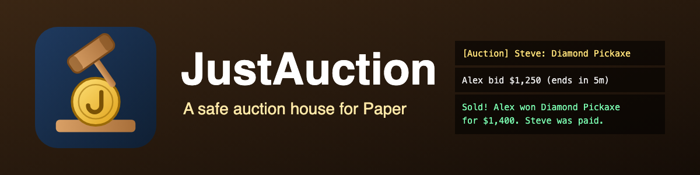

# JustAuction Wiki

**A safe, fast auction house for Paper.**

JustAuction gives your server a GUI marketplace with **fixed-price listings** and **timed auctions with bidding**. Every sale goes through one guarded state machine, so an item can never be duplicated and money can never vanish, even if the server crashes in the middle of a purchase.

| | |
| :--- | :--- |
| **Platform** | Paper `26.3` (Paper only) |
| **Java** | 25 |
| **Economy** | Vault or VaultUnlocked, plus an economy plugin that registers with it |
| **Storage** | SQLite (default) or MariaDB / MySQL |
| **Languages** | English, Czech (every message is editable) |
| **License** | MIT |
| **Source / issues** | [github.com/filasik/justAuction](https://github.com/filasik/justAuction) |

## Where to start

| I want to... | Read |
| :--- | :--- |
| Install JustAuction on my server | [Installation](Installation) |
| Understand what every option does | [Configuration](Configuration) |
| See every command and permission | [Commands and Permissions](Commands-and-Permissions) |
| Tell my players how to buy and sell | [Player Guide](Player-Guide) |
| Learn how bidding, buyouts and anti-sniping work | [Auctions](Auctions) |
| Announce sales in chat | [Public Announcements](Public-Announcements) |
| Use MySQL / MariaDB or share data between servers | [Storage and Database](Storage-and-Database) |
| Translate or restyle the messages | [Messages and Localization](Messages-and-Localization) |
| Know what happens when something goes wrong | [Safety and Recovery](Safety-and-Recovery) |
| Hook into JustAuction from my own plugin | [Developer API](Developer-API) |
| Fix a problem | [Troubleshooting](Troubleshooting) and [FAQ](FAQ) |
| Build it myself | [Building and Contributing](Building-and-Contributing) |

## Highlights

- **Auctions.** Timed auctions with bids, an optional buyout price and anti-sniping, next to fixed-price listings.
- **Dupe-proof by design.** Reserving a listing is a single guarded database update; two buyers can never both win.
- **Never blocks the server.** All database work runs off the main thread.
- **Crash-safe.** Every money step is journaled. Interrupted purchases are finished or reverted on the next start, and failed payments are refunded.
- **Nothing gets lost.** Bought, expired and cancelled items go through claim storage, so a full inventory never eats an item.
- **Works with your economy.** Anything that registers with Vault or VaultUnlocked (EssentialsX, CMI via its Vault bridge, ...).
- **Low maintenance.** Drop-in jar, SQLite by default, config auto-updates, update notices from GitHub.
- **Fully yours.** Every message is MiniMessage and editable.
- **For developers.** Cancellable API events and PlaceholderAPI placeholders.

## Quick start

1. Install **Vault** (or **VaultUnlocked**) and an economy plugin.
2. Put `JustAuction-<version>.jar` in `plugins/` and start the server.
3. Hold an item and run `/ja sell 500`. Everyone else opens the market with `/ja`.

> The first start downloads the database drivers from Maven Central, so the server needs internet access once.
