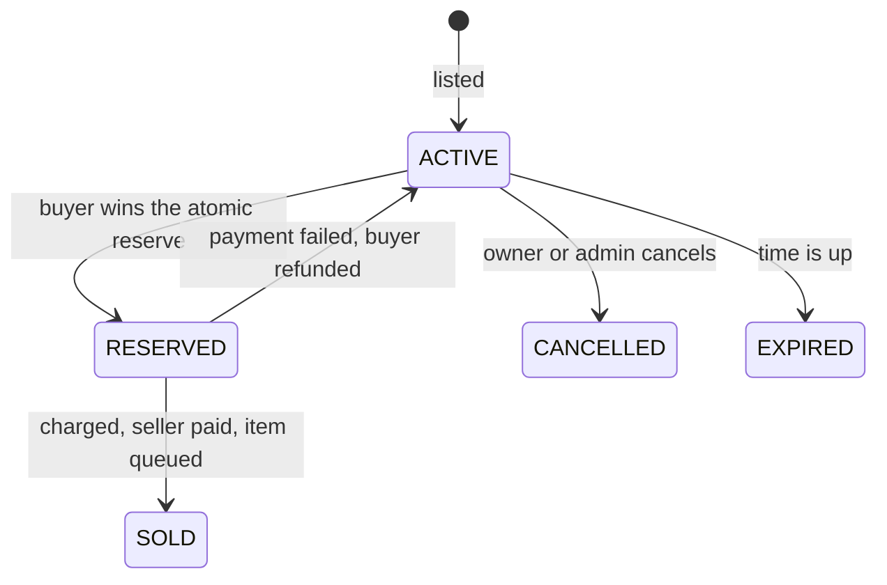

# Safety and Recovery

JustAuction is built so that an item can never be duplicated and money can never disappear, even with two buyers clicking at the same moment, an economy plugin that fails, or a server crash in the middle of a sale.

## The listing state machine

### A purchase step by step

1. **Reserve.** One guarded database update moves the listing from `ACTIVE` to `RESERVED`. Only one buyer can win it; a second buyer is turned away **before any money moves**.
2. **Charge the buyer** (journaled as stage 1).
3. **Pay the seller** the price minus the sales fee (stage 2).
4. **Complete.** In one database transaction: the listing becomes `SOLD`, the sale is written to the history, and the item is put into the buyer's claims.
5. **Deliver.** The item is given to the buyer if their inventory has room, otherwise it waits in `/ja claim`.

If a payment fails, the steps already done are reverted (the seller's payout is taken back, the buyer is refunded) and the listing goes back on sale.

An auction ends the same way: the winning bid is already held, so settling reserves the listing for the winner, pays the seller and completes the sale.

## Crash recovery

The stage column in the database is a journal of which money moves already happened. At every start, and every minute for purchases stuck longer than two minutes, JustAuction finds `RESERVED` listings that are not part of a running purchase and either **finishes** or **reverts** them based on that journal. The console reports how many were handled.

## Claims instead of direct delivery

Items never go straight from the database into an inventory. They always pass through claim storage. A claim row is deleted only after the inventory was checked to have room, and it is re-created if giving the item still fails. A full inventory or a disconnect at the wrong moment cannot lose an item.

## Refund ledger

Outbid money is written to the `ja_refunds` table in the same transaction that accepts the new bid, then paid out. A refund that cannot be paid right away (economy unavailable, crash) stays in the ledger. It is paid at the next start and retried every minute.

## Timers

| What | How often |
| :--- | :--- |
| Expire due listings (owners online are told) | every 30 s |
| Settle ended auctions | every 10 s |
| Pay pending refunds | every 60 s, plus once at startup |
| Recover stuck purchases | every 60 s, plus once at startup |
| Delete claims older than `claim-retention-days` | every hour |
| Refresh open menus | every `gui.refresh-ticks`, only while a menu is open |

## The `recovery/` folder

`plugins/JustAuction/recovery/` is a last-resort, append-only record for situations the database itself could not absorb. On a healthy server it stays empty.

| File | Meaning |
| :--- | :--- |
| `items.log` | An item that could neither be returned to the player nor stored. Contains the owner and the encoded item, so an admin can restore it. |
| `incidents.log` | A money problem an admin should look at. The console also logs these at `SEVERE`. |
| `compensated.txt` | Listings whose money was already refunded in-process, so startup recovery does not refund them twice. **Do not delete it.** |

If anything appears there, check the console log around that time, and open an [issue](https://github.com/filasik/justAuction/issues) if the cause is unclear.

## Other protections

- **No main-thread database access.** All queries run on a dedicated pool; the main thread only sees futures.
- **Hand check on listing.** The item is taken from the hand only if it is still exactly the stack the player held when they ran the command.
- **Click cooldown** in menus, and double clicks on buy, bid and cancel buttons are ignored while an action is running.
- **One listing at a time.** A player cannot start a second sell while the first is still being processed.
